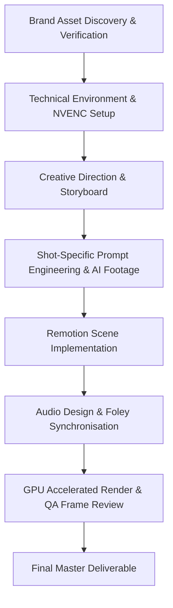

# SKILLS, REPOSITORIES & PRODUCTION WORKFLOWS FOR SANGAT LAUNCH FILM

**Document Version:** 1.0  
**Project:** Sangat Premium Brand Launch Film  
**Platform:** Google Antigravity + Remotion + React / TypeScript + NVIDIA NVENC  

---

## 1. Reference Repositories & Knowledge Integration

Two benchmark repositories were cloned into `references/` and analyzed for architectural and motion principles:

### Repository 1: `sub-level/marketing-videos`
- **Location:** `references/marketing-videos`
- **Core Principles Extracted:**
  1. **Unified Frame Function:** Every visual element is a pure function of `useCurrentFrame()`.
  2. **Timing Model:** Frame durations defined centrally in `tokens.ts`. `TOTAL_FRAMES = sum(scenes)` calculated deterministically. Absolute scene starts (`SCENE_START`) prevent desynchronization between persistent backdrops, audio cues, and scene-relative animations.
  3. **Continuous Protagonist:** The film avoids disconnected slideshow cuts. The rice grain acts as the persistent physical and narrative thread connecting macro origin to soil, hands, processing, packaging, and brand mark.
  4. **Kinetic Typography:** Word-by-word reveal using spring-driven translation, opacity, and blur with brand accent highlights (Libre Caslon Text + Playfair Display).
  5. **Audio Stack Architecture:** Tiered audio layers including ambient background bed, subtle grain movement foley, environmental nature sounds, and warm closing brand chord.

### Repository 2: `Vincentwei1021/video-shotcraft`
- **Location:** `references/video-shotcraft`
- **Core Principles Extracted:**
  1. **Shot Recipe Cards:**
     - `deck-deal-flyin` & `product-card-progressive-assemble`: Progressive layered assembly for product packaging reveal in Scene 5.
     - `transition-travel` & `circle-match-iris`: Camera dolly movement and geometric focal transitions following the grain.
     - `draw-svg-trace`: SVG path-length drawing for the Sangat rice ear symbol reveal.
     - `gradient-word-sweep`: Subtle light-sweep highlight on the brand mark and packaging typography.
  2. **2.5D Multiplane Parallax:** Layering foreground basmati stalks (`sangat-landscape-ears.svg`), midground farmers/fields (`sangat-landscape-transparent.png`), and distant mist-shrouded Himalayan foothills (`sangat-landscape.png`) with differential camera travel.
  3. **Color Arc & Lighting Modulation:** Emotional color grading progressing from deep earthy dark tones (Scene 1) to golden sunrise (Scene 2), warm documentary sunlight (Scene 3), pristine processing light (Scene 4), to warm ivory brand elegance (Scenes 5 & 6).

---

## 2. Antigravity Skill Adaptation

While the reference repos originate from Claude Code workflows, they have been adapted into **Antigravity-native configurations**:

1. **Workspace Agent Instructions:**
   - Strict avoidance of generic stock visuals or cartoonish 3D rendering.
   - Deterministic TypeScript models for all scene timings.
   - Native integration with Windows 11 hardware encoding (`ffmpeg` with `h264_nvenc` and `hevc_nvenc`).
2. **Design Tokens & Asset Resolution:**
   - Direct binding of Sangat Design System tokens (`#0F3D2E` Forest, `#F9F6EE` Ivory, `#C9A96B` Gold, `#8B6F47` Earth Brown).
   - High-DPI asset resolution scaling for vertical 1080×1920 mobile displays.
3. **Instagram Safe Zone Rules:**
   - Top Header Margin: 200px.
   - Bottom UI / Caption Margin: 380px.
   - Right Action Buttons Margin: 140px.
   - Safe Action Area: `[140, 200, 940, 1540]`.

---

## 3. Production Pipeline

